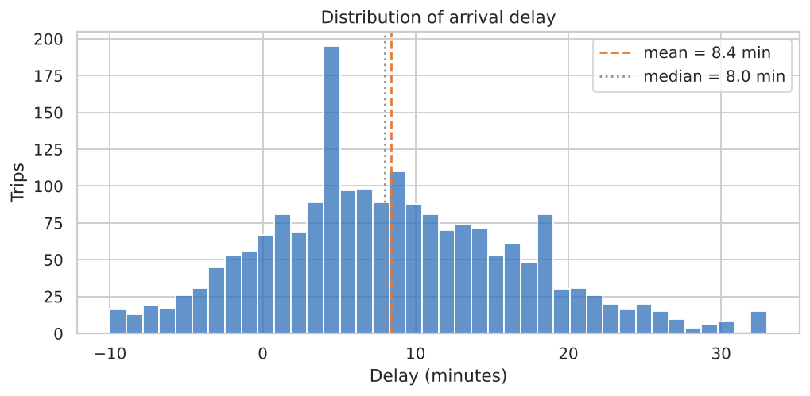
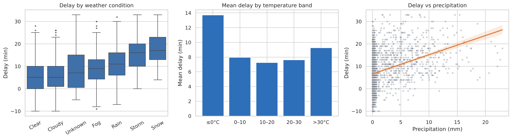
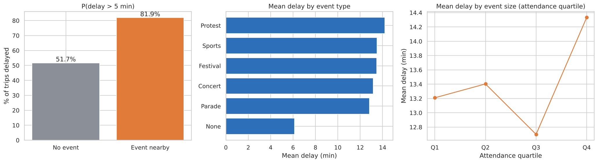
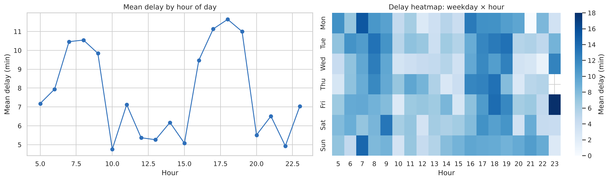
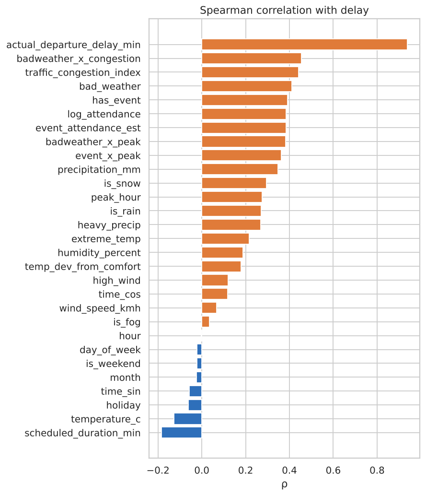
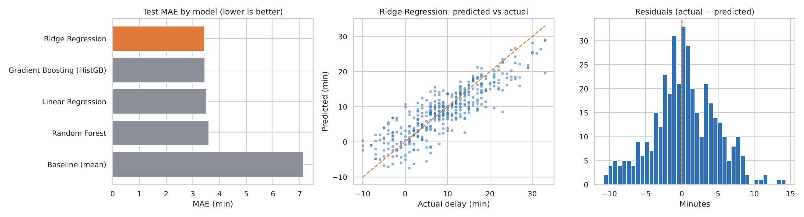
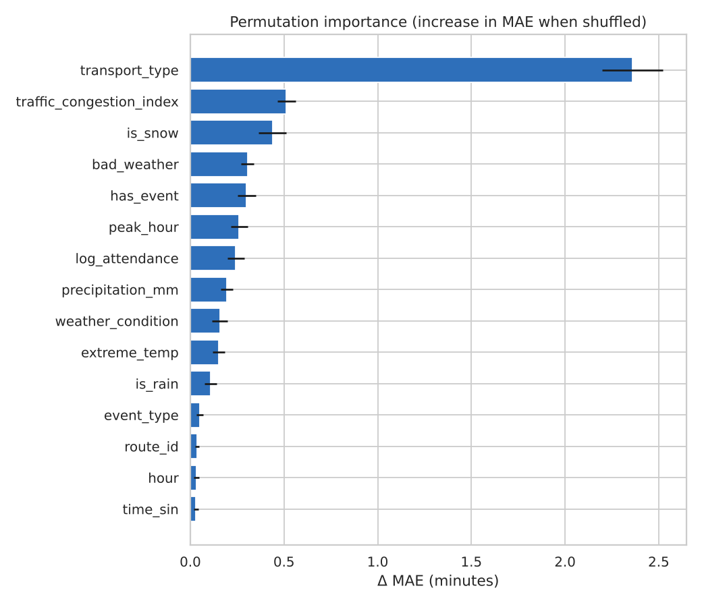

# Public Transport Delay Prediction — Results

Data: `sample_public_transport_delays.csv` — 2000 trips after cleaning. Target: `actual_arrival_delay_min` (minutes).

## 1. Delay overview

|       |   delay_min |
|:------|------------:|
| count |     2000    |
| mean  |        8.41 |
| std   |        8.28 |
| min   |      -10    |
| 25%   |        3    |
| 50%   |        8    |
| 75%   |       14    |
| max   |       33    |

## 2. Weather effects

| weather_condition   |   trips |   mean_delay |   median_delay |   pct_delayed |
|:--------------------|--------:|-------------:|---------------:|--------------:|
| Snow                |     133 |        18.28 |             17 |         99.25 |
| Storm               |     117 |        15.69 |             16 |         89.74 |
| Rain                |     398 |        10.98 |             11 |         77.89 |
| Unknown             |      15 |        10    |              7 |         60    |
| Fog                 |     130 |         9.24 |              9 |         68.46 |
| Cloudy              |     476 |         5.71 |              5 |         47.27 |
| Clear               |     731 |         5.62 |              5 |         48.29 |

Kruskal–Wallis test across weather conditions: p = 3.9e-89

Effect of each adverse condition (mean delay with vs without, Mann–Whitney p-value):

| condition    |   trips |   mean_delay_with |   mean_delay_without |   diff_min |   p_value |
|:-------------|--------:|------------------:|---------------------:|-----------:|----------:|
| is_rain      |     515 |            12.052 |                7.142 |      4.91  |     0     |
| is_snow      |     133 |            18.278 |                7.703 |     10.575 |     0     |
| is_fog       |     130 |             9.238 |                8.349 |      0.89  |     0.115 |
| extreme_temp |     320 |            12.825 |                7.565 |      5.26  |     0     |
| heavy_precip |     200 |            15.155 |                7.657 |      7.498 |     0     |
| high_wind    |     201 |            11.607 |                8.049 |      3.558 |     0     |

Mean delay by temperature band:

| temperature_c   |   mean |   count |
|:----------------|-------:|--------:|
| ≤0°C            |  13.73 |     233 |
| 0–10            |   7.95 |     535 |
| 10–20           |   7.26 |     710 |
| 20–30           |   7.62 |     382 |
| >30°C           |   9.24 |     140 |

## 3. City events

- P(delay > 5 min) **with** an event nearby: **81.9%**
- P(delay > 5 min) **without** an event: **51.7%**
- Relative risk: **1.58×** (chi-square p = 1.7e-37)

| event_type   |   trips |   mean_delay |   pct_delayed |
|:-------------|--------:|-------------:|--------------:|
| Protest      |      91 |        14.21 |         82.42 |
| Sports       |     179 |        13.49 |         86.03 |
| Festival     |     105 |        13.47 |         81.9  |
| Concert      |     163 |        13.15 |         78.53 |
| Parade       |      87 |        12.83 |         79.31 |
| None         |    1375 |         6.13 |         51.71 |

## 4. Time patterns

**Peak hour (1) vs off-peak (0)** — mean delay:

|   peak_hour |   mean_delay_min |
|------------:|-----------------:|
|           0 |             5.88 |
|           1 |            10.57 |

**Season** — mean delay:

| season   |   mean_delay_min |
|:---------|-----------------:|
| Autumn   |             7.28 |
| Spring   |             7.3  |
| Summer   |             8.08 |
| Winter   |            11.2  |

**Transport type** — mean delay:

| transport_type   |   mean_delay_min |
|:-----------------|-----------------:|
| Metro            |             2.39 |
| Train            |             4.07 |
| Tram             |            11.16 |
| Bus              |            11.58 |

## 5. Models

Chronological split (train on earliest 80% of trips, test on latest 20%); CV = 5-fold on the training set.

| model                      |   CV_MAE |   CV_RMSE |   CV_R2 |   Test_MAE |   Test_RMSE |   Test_R2 |
|:---------------------------|---------:|----------:|--------:|-----------:|------------:|----------:|
| Baseline (mean)            |    6.476 |     8.108 |  -0.002 |      7.142 |       8.926 |    -0.016 |
| Linear Regression          |    3.599 |     4.491 |   0.692 |      3.513 |       4.539 |     0.737 |
| Ridge Regression           |    3.501 |     4.39  |   0.706 |      3.43  |       4.412 |     0.752 |
| Random Forest              |    3.542 |     4.434 |   0.7   |      3.6   |       4.55  |     0.736 |
| Gradient Boosting (HistGB) |    3.558 |     4.455 |   0.697 |      3.445 |       4.422 |     0.751 |

**Best model: Ridge Regression** — test MAE 3.43 min, RMSE 4.41, R² 0.752 (baseline MAE 7.14, 52% better).

### Top features (permutation importance)

| feature                  |   importance |    std |
|:-------------------------|-------------:|-------:|
| transport_type           |       2.3598 | 0.1608 |
| traffic_congestion_index |       0.5132 | 0.0498 |
| is_snow                  |       0.4395 | 0.0739 |
| bad_weather              |       0.3049 | 0.0353 |
| has_event                |       0.301  | 0.0493 |
| peak_hour                |       0.2613 | 0.0454 |
| log_attendance           |       0.2422 | 0.045  |
| precipitation_mm         |       0.1943 | 0.0321 |
| weather_condition        |       0.157  | 0.0407 |
| extreme_temp             |       0.1519 | 0.0335 |
| is_rain                  |       0.1089 | 0.0313 |
| event_type               |       0.0521 | 0.0183 |
| route_id                 |       0.0367 | 0.0117 |
| hour                     |       0.0328 | 0.0145 |
| time_sin                 |       0.0295 | 0.0124 |

_Note: `actual_departure_delay_min` was excluded — it is only known after the trip starts, so using it would leak the answer. Run with `--include-departure-delay` to see its effect._
